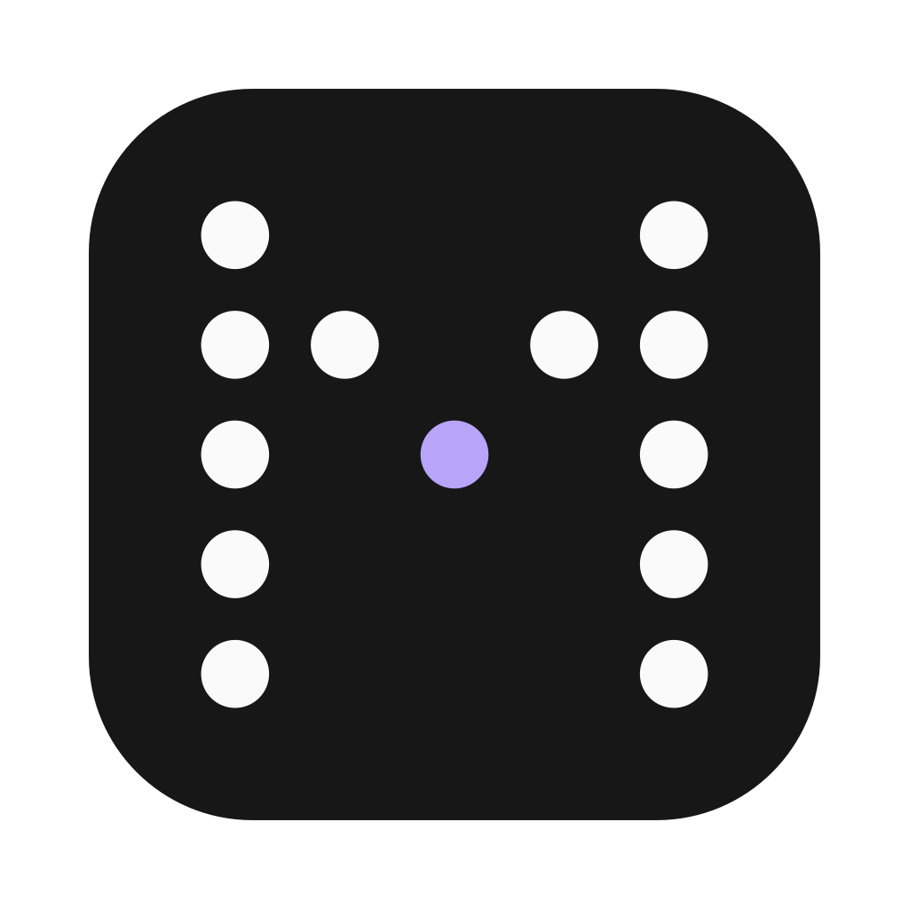

<div align="center">
  

  <h1>Mara AI</h1>

  <p>Live, translated captions for your meetings, right in the macOS menu bar.<br>
  Built for developers who work with teams in other languages.</p>

  <p>
    <a href="https://github.com/guilhermekollet/mara-ai/actions/workflows/ci.yml"></a>
    <a href="LICENSE"></a>
    
    
  </p>
</div>

Mara listens to the audio your Mac is already playing — Zoom, Google Meet, Teams, a video in the
browser — transcribes it on-device with Apple's speech recognition and shows a Portuguese caption
that forms word by word while people are still talking. No bot joins the call. When the meeting
ends, it summarizes the conversation with AI, using your own OpenAI key.

> **Language note:** the app's interface is in Brazilian Portuguese. Code, comments and docs are in
> English.

## Contents

- [Features](#features)
- [Requirements](#requirements)
- [Getting started](#getting-started)
- [Configuration](#configuration)
- [Privacy](#privacy)
- [Troubleshooting](#troubleshooting)
- [Development](#development)
- [Project layout](#project-layout)
- [Contributing](#contributing)
- [License](#license)

## Features

**Meetings in other languages**
- Live captions in a small floating window; scroll back freely, it follows the conversation again
  when you return to the bottom.
- On-device transcription and translation (Apple Speech and Translation): free, private, offline.
  Meetings in English (US), Spanish or Portuguese (Brazil).
- Optional GPT refinement of each finished sentence, with your own OpenAI key.
- A glossary of names and terms, used by speech recognition and by GPT.
- Standby after a stretch without audio, and automatic stop after a longer one.

**AI summary**
- When the meeting ends, GPT tells what was talked about, with your own OpenAI key: whether it was
  a conversation between several people or a presentation, an overview, the topics in order and,
  depending on the kind, the decisions or the key points, plus open questions. Nothing is sent
  until you ask for it.
- Its own window, with copy, save as Markdown and share; also saved next to the transcript.
- Its own model setting (GPT-6 Luna by default). Long meetings are summarized in parts.

**Everyday details**
- Global shortcuts: <kbd>⌃⌥S</kbd> start/stop, <kbd>⌃⌥L</kbd> show/hide captions.
- A usage ledger with every GPT call and its estimated cost.
- Transcripts (plain text) and summaries (Markdown) saved in `~/Documents/Mara AI`.

## Requirements

- macOS 26 (Tahoe) or later.
- To build from source: Swift 6.2 or later — Xcode 26, or the matching Command Line Tools.
- Optional: an [OpenAI API key](https://platform.openai.com/api-keys), for summaries and GPT refinement.

## Getting started

### Download

Get the latest `.zip` from [Releases](https://github.com/guilhermekollet/mara-ai/releases/latest)
(macOS 26 on Apple silicon), unzip it and move **Mara AI** to Applications.

Mara is signed but not notarized: the project has no paid Apple Developer account. The first time
you open it, macOS says it can't verify the developer. Open **System Settings → Privacy &
Security**, scroll down and click **Open Anyway** next to Mara AI. You only do this once per
version.

### Build from source

```bash
git clone https://github.com/guilhermekollet/mara-ai.git
cd mara-ai
scripts/create-signing-cert.sh   # recommended, see "Signing" below
./build.sh
open "build/Mara AI.app"
```

### First run

1. Mara lives in the menu bar (the dotted "M"). Click it and press **Iniciar**.
2. Allow **Screen & System Audio Recording** when macOS asks, then quit and reopen Mara once.
3. Pick the meeting language with the globe icon and start a call.

### Signing

macOS ties the screen-recording permission to the app's signature. An ad hoc signature changes on
every build, so macOS would ask again each time. `scripts/create-signing-cert.sh` creates a
self-signed certificate in your login keychain, which `build.sh` uses automatically. To use another
identity, set `MARA_SIGNING_IDENTITY`.

## Configuration

Everything lives in **Ajustes** (Settings), opened from the menu bar panel:

| Tab | What you set |
| --- | --- |
| Tradução | Meeting language, on-device only or Mac + GPT, GPT model, summary model, OpenAI key |
| Aparência | Caption size and background opacity, standby and auto-stop timers |
| Consumo | GPT usage per session, day, month and in total |
| Glossário | Names and terms the team uses |
| Atalhos | Turn the global shortcuts on or off |

API keys are stored in the macOS Keychain, never in files.

## Privacy

| Data | Where it goes |
| --- | --- |
| Meeting audio | Stays on your Mac. It is never sent anywhere. |
| Transcript text | Sent to OpenAI only when GPT refinement is on, or when you ask for a summary. |
| API keys | macOS Keychain. |
| Transcripts and summaries | Text and Markdown files in `~/Documents/Mara AI`. |

Mara has no server of its own: every request goes straight from your Mac to OpenAI.

## Troubleshooting

**macOS says Mara AI can't be opened.** Downloads that aren't notarized are blocked the first time.
Click **Open Anyway** in **System Settings → Privacy & Security**, as in [Download](#download).

**macOS keeps asking for the recording permission, or refuses it.** Reset it and grant it again:

```bash
tccutil reset ScreenCapture com.guilhermekollet.mara-ai
```

Releases are signed ad hoc, so after updating to a new version macOS may ask for the permission
again.

**The menu bar icon doesn't show up.** On MacBooks with a notch, icons that don't fit are hidden
behind it. Remove a few menu bar items (hold <kbd>⌘</kbd> and drag them out) and Mara appears.

**Something went wrong during a meeting.** The current session is logged, with millisecond timings,
in `~/Library/Logs/MaraAI/sessao.log`.

## Development

```bash
swift build                   # debug build
scripts/test.sh               # tests (works with Xcode or with only the Command Line Tools)
./build.sh                    # release build and app bundle
.build/debug/MaraAI --render-summary /tmp/summary.png   # draw the summary window with a sample
```

Useful runtime files:

- `~/Library/Logs/MaraAI/sessao.log` — the current session, step by step.
- `~/Library/Application Support/MaraAI/consumo.jsonl` — every GPT call, one JSON object per line.

The website lives in [`web/`](web/README.md) (Next.js, Tailwind CSS).

### Releasing

Push a version tag and `.github/workflows/release.yml` does the rest: it runs the tests, builds the
app with that version and publishes a GitHub release with the zip and its SHA-256 checksum.

```bash
git tag v0.2.0
git push origin v0.2.0
```

`scripts/package-release.sh 0.2.0` builds the same zip locally, in `dist/`.

## Project layout

```
Sources/MaraAI/
  MaraAIApp.swift            App entry point, captions window, menu bar item
  CaptionModel.swift         Session state: capture, transcription, translation, summary
  TranscriptionSession.swift Apple SpeechAnalyzer pipeline and the standby gate
  SystemAudioCapture.swift   System audio through ScreenCaptureKit (restarts if macOS stops it)
  Translator.swift           OpenAI calls (refinement, summary) and Keychain helpers
  MeetingSummary.swift       The summary's structure, its JSON schema and Markdown
  SummaryView.swift          Summary window
  MenuBarPanel.swift         Menu bar panel
  SettingsView.swift         Settings window
  …                          Theme, icons, animated captions, sound bars, hot keys, usage ledger
Tests/MaraAITests/           Swift Testing suite
scripts/                     Icon generation, signing certificate, test runner, release packaging
web/                         Website
```

## Contributing

Contributions are welcome. Read [CONTRIBUTING.md](CONTRIBUTING.md) to get set up, and the
[Code of Conduct](CODE_OF_CONDUCT.md). Found a security issue? See [SECURITY.md](SECURITY.md).

## License

[MIT](LICENSE) © Guilherme Kollet
